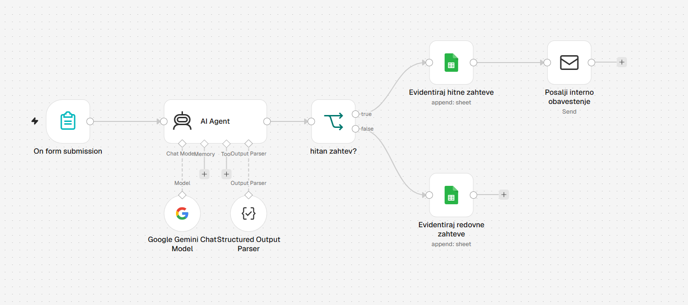

# AI-Powered Customer Support Workflow

An AI-powered customer support automation workflow built with **n8n** and **Google Gemini**. It processes incoming customer messages, classifies them by category and urgency, generates suggested responses, and stores the results in Google Sheets.

## Workflow Overview



## Features

- **Form Submission:** Collects customer information and messages through an n8n form.
- **AI-Powered Classification:** Uses Google Gemini to classify incoming messages into three categories: Sales, Service, and Other.
- **Priority Detection:** Determines whether a request is Urgent or Regular based on its content.
- **Structured Output:** Uses the Structured Output Parser to ensure consistent and structured AI responses.
- **Response Generation:** Generates context-aware suggested responses to customer inquiries.
- **Data Storage:** Records original messages, classifications, priorities, and suggested responses in Google Sheets.
- **Urgent Request Notifications:** Sends an internal email notification when an urgent request is identified.

## Tech Stack

- **n8n** – Workflow automation and orchestration
- **Google Gemini API** – AI-powered message analysis and response generation
- **Google Sheets** – Data storage and request tracking
- **Structured Output Parser** – Structured AI responses
- **Email** – Internal notifications for urgent requests

## How It Works

1. A customer submits a message through the form, providing their name, email address, and inquiry.
2. The AI Agent analyzes the submitted message using Google Gemini.
3. The request is classified into one of three categories: Sales, Service, or Other.
4. The AI determines the priority level: Urgent or Regular.
5. A suggested response is generated based on the content of the inquiry.
6. The workflow checks whether the request is urgent:
   - **Urgent:** The request is recorded in a dedicated Google Sheets branch, and an internal email notification is sent.
   - **Regular:** The request is recorded in the regular requests sheet.

## Example Results

The following examples demonstrate how the workflow processes different customer inquiries.

### Example 1: Urgent Service Request

**Customer Message:**

> Poštovani, potreban nam je servis fiskalnog uređaja koji je prestao da radi. Hitno nam je potrebna pomoć.

**AI Classification:**

| Field | Result |
|---|---|
| Category | Service |
| Priority | Urgent |
| Status | Čeka hitnu obradu |

**Generated Response:**

> Poštovani, primili smo vaš zahtev za servis fiskalnog uređaja. Naš tehnički tim će vas kontaktirati u najkraćem mogućem roku radi dogovora o daljim koracima i izlaska na teren.

**Workflow Action:** The request is recorded in Google Sheets and an internal email notification is sent.

### Example 2: Regular Inquiry

**Customer Message:**

> Dobar dan, želeo bih da se informišem o mogućnostima zaposlenja u vašoj kompaniji.

**AI Classification:**

| Field | Result |
|---|---|
| Category | Other |
| Priority | Regular |
| Status | Čeka obradu |

**Generated Response:**

> Poštovana, hvala vam na interesovanju za rad u našoj kompaniji. Vašu prijavu i upit smo prosledili našem HR sektoru, koji će vas kontaktirati ukoliko se otvori pozicija koja odgovara vašim kvalifikacijama. S poštovanjem.

**Workflow Action:** The request is recorded in Google Sheets under regular requests.

## Project Structure

```text
ai-customer-support-workflow/
│
├── workflow.json
├── README.md
└── screenshots/
    └── workflow-overview.png
```

## Setup and Configuration

To run this workflow:

1. Install or access an n8n instance.
2. Import `workflow.json` into n8n.
3. Configure your Google Gemini API credentials.
4. Connect your Google Sheets account and configure the required spreadsheets.
5. Configure email credentials for internal notifications.
6. Test the workflow by submitting sample customer inquiries through the form.

**Note:** API credentials and account connections are not included in the exported workflow and must be configured separately.

## Project Goal

The goal of this project was to explore how AI agents and workflow automation can be combined to streamline customer support operations, automate request classification, improve request organization, and ensure that urgent inquiries receive timely internal attention.
